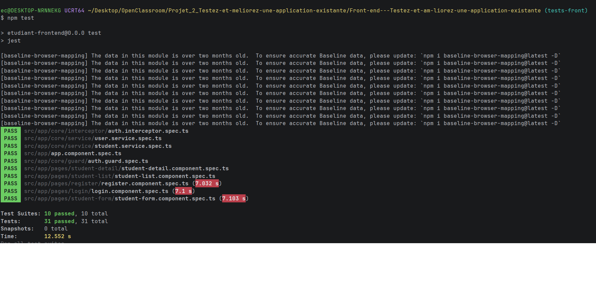
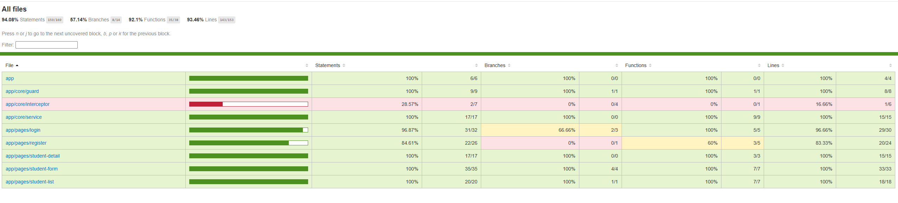
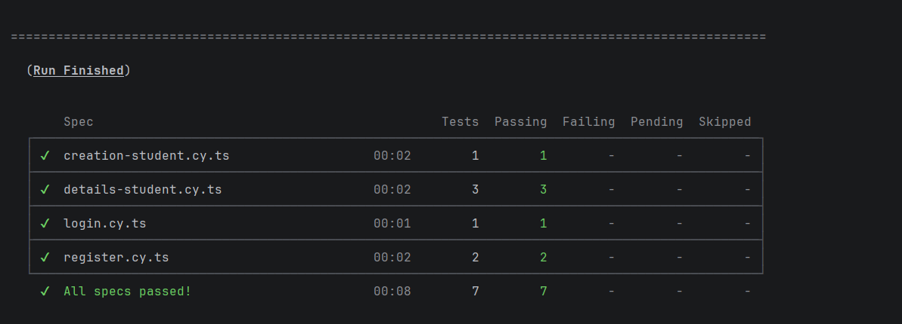
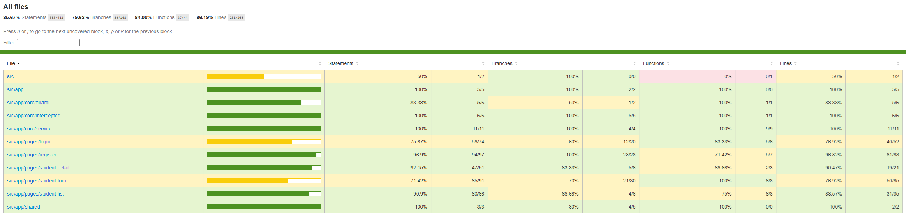

# EtuBibliothèque – Front-end

Application Angular qui permet aux agents d'une bibliothèque de créer un compte, de se connecter (JWT) et de gérer les fiches des étudiants (ajout, consultation, modification, suppression).
Elle consomme l'API REST Spring Boot du dépôt back-end : [OC_Projet_2_Back](https://github.com/stairwayTo/OC_Projet_2_Back).

---

## 1. Prérequis

| Outil | Version | Utile pour |
|---|---|---|
| Node.js | 18.19+, 20.11+ ou 22 (développé avec la v22) | tout |
| npm | fourni avec Node.js | tout |
| Back-end Spring Boot + MySQL | voir le [README du back](https://github.com/stairwayTo/OC_Projet_2_Back) (Java 21, Maven, Docker) | **uniquement** pour utiliser l'application pour de vrai |

Angular CLI 19, Jest et Cypress sont installés localement par `npm install` : aucune installation globale n'est nécessaire.

> **Faut-il lancer le back ?**
> - Pour **utiliser l'application** : oui. Le front appelle `/api/...`, et le proxy (`proxy.conf.json`) redirige ces appels vers `http://localhost:8080`.
> - Pour les **tests Jest** et **Cypress** : non. Le back est simulé (voir la section 4).

---

## 2. Installation et lancement

```bash
# 1. Récupérer le projet
git clone https://github.com/stairwayTo/OC_Projet_2_Front.git
cd OC_Projet_2_Front

# 2. Installer les dépendances
npm install

# 3. Lancer le back-end (voir son README), puis le front
npm start
```

Ouvrir ensuite <http://localhost:4200>. La page d'accueil redirige vers `/login`, avec un lien vers la création de compte.

### Pages disponibles

| Page | URL | Connexion requise |
|---|---|---|
| Connexion | <http://localhost:4200/login> | non |
| Création de compte | <http://localhost:4200/register> | non |
| Liste des étudiants | <http://localhost:4200/students> | oui |
| Ajout d'un étudiant | <http://localhost:4200/students/new> | oui |
| Détail d'un étudiant | `http://localhost:4200/students/{id}` | oui |
| Modification d'un étudiant | `http://localhost:4200/students/{id}/edit` | oui |

Sans connexion, les pages protégées redirigent vers `/login` (`authGuard`).

---

## 3. Commandes utiles

| Commande | Rôle |
|---|---|
| `npm install` | Installe les dépendances |
| `npm start` | Lance l'appli en développement sur <http://localhost:4200> (proxy `/api` vers le back sur le port 8080) |
| `npm run build` | Construit la version de production dans `dist/` |
| `npm test` | Lance tous les tests unitaires et d'intégration **Jest** et génère le rapport de couverture |
| `npm run test:watch` | Jest en mode surveillance (relance à chaque sauvegarde) |
| `npm run e2e` | Ouvre l'interface **Cypress** pour voir les tests E2E s'exécuter dans le navigateur (nécessite `npm start`) |
| `npm run e2e:ci` | Lance les tests Cypress en ligne de commande, sans fenêtre (nécessite `npm start`) |
| `npm run start:e2e` | Lance une version **instrumentée** de l'appli sur <http://localhost:4300>, utilisée pour mesurer la couverture E2E |
| `npm run e2e:coverage` | Lance les tests Cypress contre la version instrumentée et génère le rapport de couverture E2E (nécessite `npm run start:e2e`) |

---

## 4. Tests

### 4.1 Stratégie

Deux niveaux de tests complémentaires :

| | Jest (unitaires et intégration) | Cypress (end-to-end) |
|---|---|---|
| **Ce qui est testé** | Chaque service, guard et composant isolément | Des parcours utilisateur complets, dans un vrai navigateur |
| **Ce qui est simulé** | Les dépendances : services mockés avec `jest.fn()`, requêtes HTTP avec `HttpTestingController`, routeur | Uniquement le back-end, avec `cy.intercept()` : tout le front (composants, services, intercepteur, guard, routeur) tourne pour de vrai |
| **Exemple** | « `onSubmit` avec un formulaire invalide n'appelle pas le service » | « l'utilisateur se connecte, son token est stocké puis envoyé dans le header `Authorization` de l'appel suivant » |
| **Back nécessaire ?** | Non | Non |

**Fichiers exclus de la couverture** (dans Jest et dans Cypress) :

| Fichier | Raison |
|---|---|
| `*.spec.ts` | Ce sont les tests eux-mêmes |
| `app.config.ts`, `app.routes.ts` | Configuration déclarative, sans logique |
| `shared/material.module.ts` | Liste d'imports Angular Material, sans logique |
| `core/models/**` | Interfaces TypeScript, rien n'est exécuté |
| `core/service/user-mock.service.ts` | Mock de test, pas du code applicatif |

### 4.2 Tests unitaires et d'intégration (Jest)

```bash
npm test
```

**10 suites, 31 tests**, couvrant :
- les services `StudentService` et `UserService` (requêtes HTTP vérifiées avec `HttpTestingController`) ;
- le guard `authGuard` ;
- les composants `login`, `register`, `student-list`, `student-detail` et `student-form` (création et modification).

**Rapport HTML** : `coverage/index.html`, à ouvrir dans un navigateur.

Depuis le terminal :



Rapport version HTML :



### 4.3 Tests end-to-end (Cypress)

**4 specs, 7 tests**, dans `cypress/e2e/` :

| Spec | Scénarios |
|---|---|
| `register.cy.ts` | Création de compte puis redirection vers `/login` ; formulaire vide refusé sans appel à l'API |
| `login.cy.ts` | Connexion réussie : token stocké, redirection vers `/students`, header `Authorization` envoyé à l'appel suivant |
| `creation-student.cy.ts` | Ajout d'un étudiant puis affichage dans la liste |
| `details-student.cy.ts` | Affichage du détail ; modification avec formulaire pré-rempli ; suppression après confirmation |

**Lancer les tests** (sans couverture) :

```bash
# Terminal 1
npm start
# Terminal 2
npm run e2e        # avec l'interface graphique
npm run e2e:ci     # en ligne de commande
```

**Lancer les tests avec la couverture** :

Cypress ne mesure pas la couverture lui-même : le code doit être **instrumenté** (compteurs Istanbul ajoutés à la compilation). Angular 19 compile avec esbuild, qui ne sait pas instrumenter. Une cible webpack dédiée (`build-e2e` / `serve-e2e` dans `angular.json`, avec `cypress/coverage.webpack.js`) ajoute donc ces compteurs, uniquement pour ces tests. Le plugin `@cypress/code-coverage` récupère ensuite les compteurs après chaque test et génère le rapport avec `nyc`.

```bash
# Terminal 1 : appli instrumentée sur le port 4300
npm run start:e2e
# Terminal 2 : tests + rapport
npm run e2e:coverage
```

**Rapport HTML** : `coverage-e2e/index.html`. Le seuil de **80 %** (statements, lines, functions) est vérifié automatiquement par `nyc` (voir `.nycrc.json`) : la commande échoue s'il n'est pas atteint.

Depuis le terminal :



Rapport version HTML :


